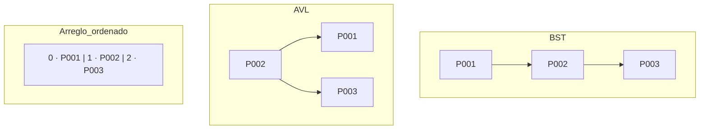
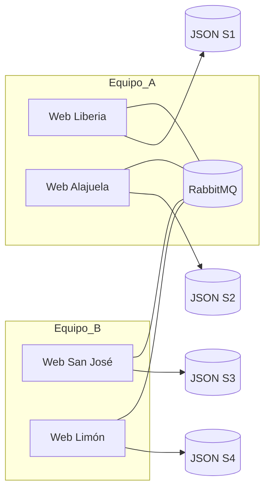
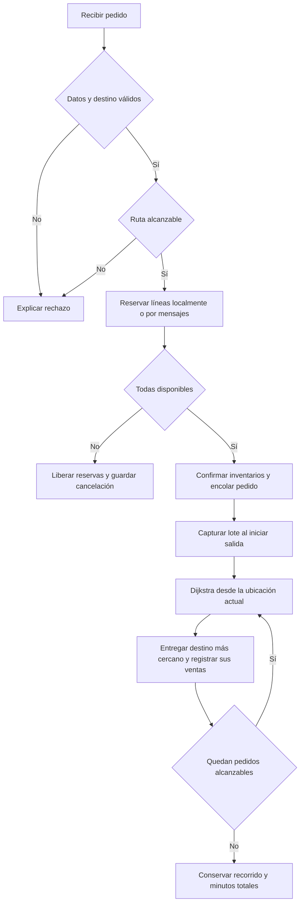

# Diseño de ConviTEC

## DI1 · Necesidades y requerimientos

El dependiente registra pedidos con existencias de toda la cadena. Cada sede responde por su inventario, sus ventas y los tiempos de sus entregas. La disponibilidad global puede tardar en actualizarse. Solo la sede propietaria puede aceptar una reserva.

| ID | Requerimiento funcional | Criterio observable |
|---|---|---|
| RF01 | Consultar catálogo global | Un mismo código muestra cantidades por sede. |
| RF02 | Consultar y reponer inventario local | Agregar unidades aumenta el disponible y difunde el cambio. |
| RF03 | Registrar productos, cantidades y destino | Se conservan precios, fecha, sede y proveedores. |
| RF04 | Validar y reservar | Una línea inválida o una reserva insuficiente impide confirmar el pedido completo. |
| RF05 | Validar conectividad | Liberia puede abastecer otras sedes y entregar en Cañas. Rechaza Cartago. |
| RF06 | Consultar pendientes e historial | Un pedido entregado desaparece de pendientes y permanece en historial. |
| RF07 | Distribuir dos veces al día | A las 11 y 15 de Costa Rica se captura el lote disponible. |
| RF08 | Avanzar una parada | Dijkstra elige el destino más próximo desde la posición actual y agrupa todos sus pedidos del lote. |
| RF09 | Registrar entregas y ventas | Cada pedido registra los minutos acumulados y genera una venta local con líneas, fecha y monto. |
| RF10 | Calcular estadísticas | Sumar subtotales por código y clasificar entregados por colones por minuto. |
| RF11 | Aislar registros locales | Cada instancia publica sus propios pedidos, ventas, rutas e inventario. |

| ID | Requerimiento no funcional | Alcance |
|---|---|---|
| RN01 | Cuatro integrantes activos | Evidencia individual en Git y defensa. |
| RN02 | C# orientado a objetos | Servicios de dominio en Core. |
| RN03 | Separación de capas | Web delega operaciones en Core. |
| RN04 | Git | Ramas main y development. |
| RN05 | Cinco contribuciones significativas por integrante | Revisar autoría y contenido por persona. |
| RN06 | Colecciones propias | Lista, Cola, ArbolAVL y arreglos. |
| RN07 | Catálogo jerárquico | Índice AVL por código. |
| RN08 | Grafo ponderado no dirigido | Matriz simétrica en minutos. |
| RN09 | Algoritmos propios | Búsquedas, recorridos y merge sort. |
| RN10 | Dijkstra desde la ubicación actual | Recalcular después de cada parada. |
| RN11 | Casos especiales | Vacíos, duplicados, inalcanzables y traslado cero. |
| RN12 | Cuatro instancias en dos computadoras | Código de sede y puerto independientes. |
| RN13 | Mensajería | RabbitMQ transporta solicitudes, respuestas y actualizaciones. |
| RN14 | Propiedad de los datos | Cada proceso escribe solo en su carpeta. |
| RN15 | Persistencia | Inventario, pedidos, ventas y recorrido en archivos locales. |
| RN16 | Recuperación | Reconstruir índices, cola y último paso al reiniciar. |
| RN17 | Almacenamiento sin SGBD | JSON y estructuras en memoria. |
| RN18 | Calidad y errores | Validar entradas y explicar motivos de rechazo. |
| RN19 | Pruebas | Casos normales, límites, persistencia y comunicación. |
| RN20 | Documentación | README, diseño y UML versionados. |
| RN21 | Comprensión individual | Cada integrante demuestra y justifica su contribución en la defensa. |
| RN22 | Recursos y costo del ciclo de vida | Reutilizar los dos equipos y un broker. El modelo no calcula costos monetarios de operación. |
| RN23 | Salud y seguridad pública | No aplica al simulador sin vehículos físicos ni decisiones de seguridad vial. |
| RN24 | Carbono neto cero e impacto ambiental | No aplica como métrica verificable. Los pesos representan minutos y faltan distancias, combustible y emisiones. |
| RN25 | Contexto cultural y social | Interfaz en español, colones y horarios de Costa Rica. |

## DI2 · Alternativas para el catálogo

Con inserción de P001, P002 y P003, el BST simple sigue el orden de llegada. El AVL aplica una rotación cuando detecta el desnivel.

| Opción | Búsqueda en peor caso | Inserción en peor caso | Costo práctico |
|---|---|---|---|
| BST simple | O(n) | O(n) | Implementación sencilla, sensible a códigos secuenciales. |
| Arreglo ordenado | O(log n) | O(n) | Memoria contigua, desplaza elementos al insertar. Carece de jerarquía. |
| AVL | O(log n) | O(log n) | Cada nodo almacena altura y requiere rotaciones. |

Se elige AVL para RF01–RF04 y RN07. El recorrido en orden lista los códigos en O(n). La matriz del grafo usa O(V²) de memoria y cada ejecución de Dijkstra tarda O(V²). Una parada añade el costo de recorrer el lote y consultar sus pedidos. Merge sort usa O(n log n) tiempo y O(n) espacio auxiliar.

## DI3 · Arquitectura y flujo

El botón ejecuta una parada por pulsación. Un pedido aceptado durante un recorrido queda para el lote siguiente. En igualdad de distancia se atiende primero el destino del pedido más antiguo en la cola. El total termina en la última entrega. El saldo por minuto se calcula con el tiempo acumulado de cada pedido. Los empates de rendimiento conservan el orden del historial.

## DI4 · Validación

| Requisitos | Evidencia reproducible | Límite |
|---|---|---|
| RF01–RF06, RN06–RN08, RN13–RN19 | Ejecutar ConviTEC.Pruebas con RabbitMQ. Revisar sincronización, reservas, cancelación y recuperación. | Una suite con casos omitidos requiere repetirla con el broker disponible. |
| RF07–RF09, RN09–RN11 | Suite de recorridos desde San José. Heredia a 20 min y Cartago a 85 min acumulados. Dos pedidos en Cartago producen dos ventas. Se reinicia el servicio entre pasos. | Despachar se prueba por invocación. Para observar el reloj real mantener el proceso abierto a las 11 o 15. |
| RF10, RN11 | Pruebas de empate, ventas vacías, precio acumulado y tiempo cero. Merge sort con 0, 1 y valores repetidos. | División por cero se presenta al final como «Sin traslado». |
| RF11, RN02, RN03, RN12, RN14 | Abrir cada puerto y consultar sede, pendientes, ventas y catálogo después de registrar un pedido. | Para acreditar las dos computadoras se requiere una demostración en LAN. |
| RN01, RN04, RN05, RN21 | Revisar grafo de Git, explicar Dijkstra, AVL, reservas y pruebas en defensa. | La participación y defensa individual requieren evidencia del grupo. |
| RN20, RN22–RN25 | Inspeccionar README, UML, despliegue y presentación de montos. | El sistema no mide emisiones, presupuesto ni seguridad vial. |
